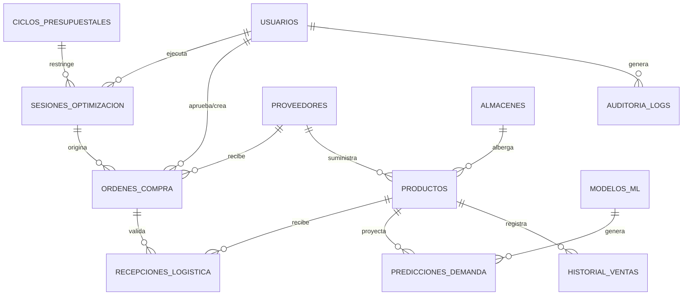

# **Modelo de Datos y Arquitectura de BD - SAAML**
### Sistema de Aprovisionamiento Autónomo basado en Machine Learning y Restricciones Presupuestales

---

## 1. Análisis de Brechas y Mejoras Incorporadas

Comparando el **Documento de Requerimientos (DRS)** con la **Arquitectura Inicial de Base de Datos**, se identificaron las siguientes adiciones críticas necesarias antes de comenzar el desarrollo:

1. **Relación Producto ↔ Proveedor (`proveedor_id` en Productos):**
   * *Problema inicial:* La colección `Productos` tenía costos y lead time, pero ninguna vinculación con la colección `Proveedores`. El optimizador (Knapsack) no sabía a qué proveedor correspondía cada SKU ni a quién emitir la orden.
   * *Solución:* Se vincula `proveedor_id` como referencia en `Productos` (con soporte para catálogo de proveedores alternativos).

2. **Colección `Predicciones_Demanda` (RF02, RF04):**
   * *Problema inicial:* No existía persistencia para las inferencias del modelo de Machine Learning.
   * *Solución:* Se creó la colección `Predicciones_Demanda` para desacoplar el módulo predictivo (RF02) del optimizador (RF04), permitiendo simular múltiples presupuestos sin re-ejecutar el modelo de ML y auditando la precisión contra ventas reales.

3. **Promoción de `Auditoria_Modelos_ML` a Fase 1 (RF06):**
   * *Problema inicial:* Estaba catalogada como Fase 2, pero el requerimiento **RF06 (Entrenamiento Continuo)** exige monitoreo de re-entrenamiento desde la versión inicial.
   * *Solución:* Pasa al núcleo principal para registrar versiones (`v1.0.0`), hiperparámetros, fechas de corte y métricas de error (MAPE, RMSE, MAE).

4. **Colección `Sesiones_Optimizacion` (RF03, RF04, RF05, RNF01):**
   * *Problema inicial:* El DRS contempla la entrada dinámica de restricciones de capital y el cumplimiento del tiempo de respuesta (< 30s). No había registro del proceso de optimización, solo la orden final.
   * *Solución:* Colección que almacena el presupuesto ingresado, el solver utilizado (PuLP, SciPy, OR-Tools), tiempo de ejecución en milisegundos, status del algoritmo (OPTIMAL/FEASIBLE) y porcentaje de demanda cubierta.

5. **Asignación de Proveedor en `Ordenes_Compra` (RF05):**
   * *Problema inicial:* La orden de compra tenía items de productos pero no definía a qué proveedor comercial se dirigía la orden.
   * *Solución:* `Ordenes_Compra` incluye `proveedor_id` y `sesion_optimizacion_id` para trazabilidad punta a punta.

6. **Seguridad y Auditoría Robusta (RNF-SEG):**
   * *Problema inicial:* Faltaban campos para control de ataques de fuerza bruta y revocación de sesiones JWT.
   * *Solución:* En `Usuarios` se incorporan `intentos_fallidos`, `bloqueado_hasta` y `token_version`. Se incorpora la colección `Logs_Seguridad_Auditoria`.

7. **Estrategia de Indexación para Rendimiento (RNF01):**
   * Definición explícita de índices compuestos en series de tiempo (`Historial_Ventas`), proyecciones y códigos únicos.

---

## 2. Diagrama Entidad-Relación Documental (ERD)

---

## 3. Diccionario de Datos Completo (MongoDB / NoSQL)

### 3.1. Colección: `Usuarios`
*Control de acceso, roles y seguridad (RNF-SEG).*
* `_id`: `ObjectId` (PK)
* `email`: `String` (Único, Lowercase, Requerido)
* `password_hash`: `String` (Argon2id o Bcrypt, Requerido)
* `nombre_completo`: `String`
* `rol`: `String` (Enum: `"ADMIN"`, `"GERENTE_COMPRAS"`, `"OPERADOR"`, `"SISTEMA_ML"`)
* `estado`: `String` (Enum: `"ACTIVO"`, `"SUSPENDIDO"`, `"BLOQUEADO"`)
* `intentos_fallidos`: `Integer` (Default: 0)
* `bloqueado_hasta`: `Date | Null`
* `token_version`: `Integer` (Default: 1, para invalidación masiva de JWTs)
* `ultimo_acceso`: `Date`
* `created_at`: `Date`
* `updated_at`: `Date`
* **Índices:** `{ email: 1 }` (Único)

---

### 3.2. Colección: `Proveedores`
*Gestión de suministros, lead times y confiabilidad (RF01, RF04).*
* `_id`: `ObjectId` (PK)
* `codigo_proveedor`: `String` (Único)
* `nombre_empresa`: `String` (Requerido)
* `contacto`: `Object` `{ nombre: String, email: String, telefono: String }`
* `moneda`: `String` (ISO 4217, ej. `"USD"`, `"COP"`, `"MXN"`)
* `condiciones_pago`: `String` (ej. `"30_DIAS"`, `"CONTADO"`)
* `calificacion_calidad`: `Double` (1.0 a 5.0)
* `variabilidad_lead_time_dias`: `Double` (Desviación estándar observada)
* `lead_time_promedio_dias`: `Integer`
* `estado`: `String` (Enum: `"ACTIVO"`, `"INACTIVO"`)
* `created_at`: `Date`
* `updated_at`: `Date`
* **Índices:** `{ codigo_proveedor: 1 }` (Único), `{ estado: 1 }`

---

### 3.3. Colección: `Almacenes`
*Restricción física de cubicaje para el optimizador (RF04).*
* `_id`: `ObjectId` (PK)
* `codigo_almacen`: `String` (Único)
* `nombre_almacen`: `String`
* `ubicacion`: `String`
* `capacidad_total_volumen_cm3`: `Double` (Requerido)
* `capacidad_ocupada_actual_cm3`: `Double` (Default: 0.0)
* `costo_mantenimiento_inventario_porcentaje`: `Double` (Tasa mensual o anual)
* `estado`: `String` (Enum: `"ACTIVO"`, `"MANTENIMIENTO"`)
* **Índices:** `{ codigo_almacen: 1 }` (Único)

---

### 3.4. Colección: `Productos`
*Catálogo maestro de ítems, restricciones de orden y volumen (RF01, RF04).*
* `_id`: `ObjectId` (PK)
* `sku_code`: `String` (Único, Indexado)
* `nombre`: `String` (Requerido)
* `categoria`: `String` (Indexado)
* `proveedor_id`: `ObjectId` (Ref: `Proveedores`, Requerido)
* `almacen_id`: `ObjectId` (Ref: `Almacenes`, Requerido)
* `costo_unitario`: `Decimal128` (Requerido)
* `precio_venta`: `Decimal128` (Requerido)
* `stock_actual`: `Integer` (Requerido)
* `stock_seguridad`: `Integer` (Calculado o fijo)
* `moq`: `Integer` (Minimum Order Quantity, Default: 1)
* `incremento_lote`: `Integer` (Unidades por empaque/caja, Default: 1)
* `volumen_cm3`: `Double` (Para cálculo de capacidad volumétrica en almacén)
* `peso_kg`: `Double`
* `lead_time_promedio_dias`: `Integer`
* `estado`: `String` (Enum: `"ACTIVO"`, `"DISCONTINUADO"`)
* `audit`: `Object` `{ created_at: Date, updated_at: Date }`
* **Índices:** `{ sku_code: 1 }` (Único), `{ categoria: 1 }`, `{ proveedor_id: 1 }`, `{ estado: 1 }`

---

### 3.5. Colección: `Historial_Ventas`
*Series de tiempo para el entrenamiento e inferencia de Machine Learning (RF01, RF02).*
* `_id`: `ObjectId` (PK)
* `sku_id`: `ObjectId` (Ref: `Productos`, Indexado)
* `fecha`: `Date` (ISO, Indexado)
* `cantidad_vendida`: `Integer` (Requerido)
* `precio_unitario_aplicado`: `Decimal128`
* `descuento_porcentaje`: `Double` (Default: 0.0)
* `stockout_flag`: `Boolean` (True si hubo quiebre de inventario ese día, ayuda al modelo a corregir demanda censurada)
* `canal_venta`: `String` (Enum: `"ONLINE"`, `"RETAIL"`, `"B2B"`)
* `almacen_id`: `ObjectId` (Ref: `Almacenes`)
* **Índices:** 
  * `{ sku_id: 1, fecha: -1 }` (Compuesto, vital para consultar histórico cronológico de cada SKU)
  * `{ fecha: -1 }`

---

### 3.6. Colección: `Eventos_Calendario`
*Variables exógenas / características externas para los modelos de ML (RF02).*
* `_id`: `ObjectId` (PK)
* `nombre_evento`: `String`
* `tipo_evento`: `String` (Enum: `"FERIADO"`, `"CAMPAÑA"`, `"BLACK_FRIDAY"`, `"CYBER_DAY"`, `"DESASTRE"`)
* `fecha_inicio`: `Date` (ISO)
* `fecha_fin`: `Date` (ISO)
* `multiplicador_esperado_demanda`: `Double` (Factor de ajuste inicial, ej: 1.5)
* `categorias_afectadas`: `Array[String]` (Vacío = aplica a todas)
* **Índices:** `{ fecha_inicio: 1, fecha_fin: 1 }`

---

### 3.7. Colección: `Ciclos_Presupuestales`
*Límites de capital definidos por la gerencia (RF03).*
* `_id`: `ObjectId` (PK)
* `codigo_ciclo`: `String` (ej. `"2026-Q4-M10"`, Único)
* `periodo`: `String` (ej. `"OCTUBRE_2026"`)
* `fecha_inicio`: `Date`
* `fecha_fin`: `Date`
* `presupuesto_total_asignado`: `Decimal128` (Requerido)
* `presupuesto_comprometido`: `Decimal128` (En órdenes generadas)
* `presupuesto_consumido_real`: `Decimal128` (En recepciones facturadas)
* `estado`: `String` (Enum: `"ABIERTO"`, `"CERRADO"`, `"CONGELADO"`)
* `created_by`: `ObjectId` (Ref: `Usuarios`)
* **Índices:** `{ codigo_ciclo: 1 }` (Único), `{ estado: 1 }`

---

### 3.8. Colección: `Modelos_ML` (Auditoría y MLOps)
*Trazabilidad de experimentos, reentrenamiento continuo y drift (RF06).*
* `_id`: `ObjectId` (PK)
* `version_modelo`: `String` (ej. `"v1.2.0"`, Único)
* `algoritmo`: `String` (ej. `"LightGBM"`, `"Prophet"`, `"XGBoost"`)
* `fecha_entrenamiento`: `Date` (ISO)
* `dataset_referencia_hash`: `String`
* `hiperparametros`: `Object`
* `metricas_error`: `Object` `{ mape: Double, rmse: Double, mae: Double, r2: Double }`
* `artefacto_url`: `String` (Ruta a S3, MLflow o almacenamiento local)
* `estado_despliegue`: `String` (Enum: `"PRODUCCION"`, `"STAGING"`, `"ARCHIVADO"`)
* **Índices:** `{ version_modelo: 1 }` (Único), `{ estado_despliegue: 1 }`

---

### 3.9. Colección: `Predicciones_Demanda`
*Pronóstico generado por SKU para un horizonte específico (RF02).*
* `_id`: `ObjectId` (PK)
* `modelo_version`: `String` (Ref: `Modelos_ML.version_modelo`)
* `sku_id`: `ObjectId` (Ref: `Productos`, Indexado)
* `fecha_generacion`: `Date` (ISO)
* `horizonte_dias`: `Integer` (ej. 7, 15, 30 días)
* `fecha_inicio_proyeccion`: `Date`
* `fecha_fin_proyeccion`: `Date`
* `demanda_predicha`: `Double` (Unidades proyectadas)
* `intervalo_p10`: `Double` (Percentil 10 pesimista)
* `intervalo_p90`: `Double` (Percentil 90 optimista)
* `stock_proyectado_agotamiento`: `Date | Null`
* **Índices:** 
  * `{ sku_id: 1, fecha_inicio_proyeccion: 1 }` (Compuesto)
  * `{ fecha_generacion: -1 }`

---

### 3.10. Colección: `Sesiones_Optimizacion`
*Registro y telemetría del algoritmo de investigación de operaciones Knapsack (RF04, RNF01).*
* `_id`: `ObjectId` (PK)
* `ciclo_presupuestal_id`: `ObjectId` (Ref: `Ciclos_Presupuestales`)
* `usuario_id`: `ObjectId` (Ref: `Usuarios`)
* `fecha_ejecucion`: `Date` (ISO)
* `presupuesto_disponible`: `Decimal128`
* `parametros_config`: `Object` `{ considerar_volumen_almacen: Boolean, factor_seguridad: Double }`
* `tiempo_ejecucion_ms`: `Integer` (Monitoreo RNF01 < 30,000 ms)
* `solver_status`: `String` (Enum: `"OPTIMAL"`, `"FEASIBLE"`, `"INFEASIBLE"`, `"ERROR"`)
* `demanda_total_cubierta_porcentaje`: `Double`
* `presupuesto_total_asignado`: `Decimal128`
* `skus_seleccionados_conteo`: `Integer`
* **Índices:** `{ ciclo_presupuestal_id: 1 }`, `{ fecha_ejecucion: -1 }`

---

### 3.11. Colección: `Ordenes_Compra`
*Recomendación de compra optimizada aprobada o en revisión (RF05).*
* `_id`: `ObjectId` (PK)
* `codigo_orden`: `String` (Único, ej. `"PO-2026-0001"`)
* `sesion_optimizacion_id`: `ObjectId` (Ref: `Sesiones_Optimizacion`)
* `ciclo_presupuestal_id`: `ObjectId` (Ref: `Ciclos_Presupuestales`)
* `proveedor_id`: `ObjectId` (Ref: `Proveedores`, Requerido)
* `almacen_id`: `ObjectId` (Ref: `Almacenes`)
* `fecha_generacion`: `Date` (ISO)
* `fecha_entrega_estimada`: `Date` (Calculada según lead times)
* `costo_total_orden`: `Decimal128`
* `estado`: `String` (Enum: `"BORRADOR_PROPUESTA"`, `"APROBADA"`, `"ENVIADA_PROVEEDOR"`, `"RECIBIDA_PARCIAL"`, `"RECIBIDA_TOTAL"`, `"CANCELADA"`)
* `nivel_confianza_ml_promedio`: `Double`
* `items`: `Array[Object]`
  * `sku_id`: `ObjectId` (Ref: `Productos`)
  * `sku_code`: `String`
  * `nombre_producto`: `String`
  * `cantidad_sugerida_ml`: `Integer` (Sugerencia exacta del algoritmo Knapsack)
  * `cantidad_final_aprobada`: `Integer` (Por si el gerente realiza ajustes)
  * `costo_unitario`: `Decimal128`
  * `subtotal`: `Decimal128`
  * `volumen_total_cm3`: `Double`
* `audit`: `Object`
  * `generado_por`: `ObjectId` (Ref: `Usuarios` o `"SISTEMA_ML"`)
  * `aprobado_por`: `ObjectId | Null` (Ref: `Usuarios`)
  * `fecha_aprobacion`: `Date | Null`
* **Índices:** `{ codigo_orden: 1 }` (Único), `{ proveedor_id: 1 }`, `{ estado: 1 }`, `{ fecha_generacion: -1 }`

---

### 3.12. Colección: `Recepciones_Logistica`
*Trazabilidad de cumplimiento de proveedores y cálculo dinámico de lead time real.*
* `_id`: `ObjectId` (PK)
* `orden_compra_id`: `ObjectId` (Ref: `Ordenes_Compra`, Indexado)
* `proveedor_id`: `ObjectId` (Ref: `Proveedores`)
* `sku_id`: `ObjectId` (Ref: `Productos`)
* `cantidad_prometida`: `Integer`
* `cantidad_recibida_real`: `Integer`
* `fecha_entrega_prometida`: `Date` (ISO)
* `fecha_recepcion_real`: `Date` (ISO)
* `dias_desviacion`: `Integer` (`fecha_recepcion_real` - `fecha_entrega_prometida`)
* `estado_calidad`: `String` (Enum: `"CONFORME"`, `"RECHAZADO_PARCIAL"`, `"RECHAZADO_TOTAL"`)
* `created_at`: `Date`
* **Índices:** `{ orden_compra_id: 1 }`, `{ sku_id: 1 }`

---

### 3.13. Colección: `Logs_Seguridad_Auditoria` (RNF-SEG)
*Registro inmutable para cumplir con trazabilidad y prevención de fugas.*
* `_id`: `ObjectId` (PK)
* `timestamp`: `Date` (ISO, Indexado)
* `usuario_id`: `ObjectId | Null`
* `ip_origen`: `String`
* `user_agent`: `String`
* `accion`: `String` (ej. `"LOGIN_FAILED"`, `"OPTIMIZE_TRIGGERED"`, `"ORDER_APPROVED"`, `"BUDGET_MODIFIED"`)
* `recurso_afectado`: `String`
* `detalles`: `Object`
* `nivel`: `String` (Enum: `"INFO"`, `"WARNING"`, `"CRITICAL"`)
* **Índices:** `{ timestamp: -1 }`, `{ accion: 1 }`, `{ usuario_id: 1 }`
